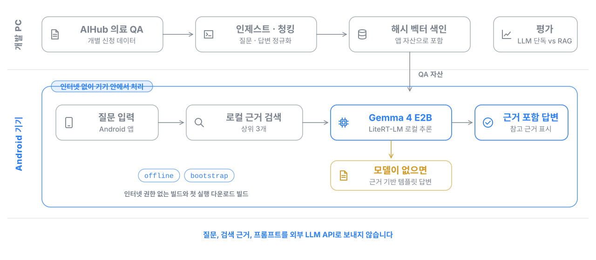

# MedEdge RAG — 근거 추적형 온디바이스 의료 질의응답


외부 서버 없이 Android 기기 안에서 의료 질문에 답하는 RAG 시스템입니다. 기기에 저장한 의료 문답 데이터에서 근거를 찾아 소형 LLM(Gemma 4 E2B)에 전달하고, 답변과 함께 참고한 근거를 보여 줍니다.

한국정보기술학회 2026 하계종합학술대회에서 「근거 추적형 로컬 RAG 기반 온디바이스 의료 질의응답 시스템」으로 발표했습니다(제1저자).

## 한눈에 보기

- **문제**: 의료 질문은 민감한 정보라 외부 LLM API로 보내기 어렵고, 소형 모델 단독으로는 근거 없는 답을 만들기 쉽습니다.
- **내가 한 일**: 데이터 인제스트와 색인, Android 앱의 로컬 검색과 LiteRT-LM 추론, 근거 표시, LLM 단독과 RAG를 비교하는 평가까지 설계하고 구현했습니다.
- **결과**: 인터넷 권한이 없는 빌드에서 전체 과정이 동작하고, 학회 발표 기준 질문당 평균 응답 9.7초, 근거 검색 평균 4.5ms를 기록했습니다. 검색 적용 전후의 답변 품질은 RAGAS로 비교했습니다.

## 구조



- **offline 빌드**: `android.permission.INTERNET`을 선언하지 않는 온디바이스 증명용 빌드입니다. 모델은 ADB로 미리 배치합니다.
- **bootstrap 빌드**: 첫 실행에서 모델을 내려받아 SHA-256을 확인한 뒤 앱 내부에 저장하고, 이후 추론은 로컬 모델만 사용합니다.
- 모델 파일이 없으면 외부 호출 없이 검색 근거 기반 템플릿 답변으로 대체합니다.

## 빠른 시작

AIHub 의료 QA 데이터는 재배포할 수 없어 [AIHub](https://aihub.or.kr)에서 이용 신청 후 로컬에 둡니다. API 키, 원본 데이터, 모델 가중치는 저장소에 포함하지 않습니다.

```powershell
python -m venv .venv
.\.venv\Scripts\Activate.ps1
python -m pip install -e .
python -m mededge_rag.cli ingest --input data/sample/medical_qa_sample.jsonl --index data/index/mededge_index.json
python -m mededge_rag.cli ask --index data/index/mededge_index.json --question "아이가 고열일 때 언제 응급실에 가야 하나요?"
python -m mededge_rag.cli eval --index data/index/mededge_index.json --queries experiments/queries.jsonl --output experiments/benchmark.csv
```

로컬에 Ollama와 `gemma4:e2b` 모델이 있으면 개발 경로의 생성 단계에서 로컬 LLM을 호출하고, 없으면 템플릿 답변으로 대체합니다. Streamlit 데모는 `pip install -e ".[app]"` 후 `streamlit run src/mededge_rag/app/streamlit_app.py`로 실행합니다.

**Android 앱**

```powershell
adb shell mkdir -p /data/local/tmp/llm/
adb push .\models\gemma-4-E2B-it.litertlm /data/local/tmp/llm/gemma-4-E2B-it.litertlm
cd android\MedEdgeRag
.\gradlew.bat :app:assembleOfflineDebug
```

모델 준비, 에뮬레이터 구성, 기기 검증 스크립트는 [docs/android.md](docs/android.md)에, RAGAS 평가와 데이터 연결 방법은 [docs/evaluation.md](docs/evaluation.md)에 정리했습니다.

## 디렉터리 구조

```text
ondevice-medical-rag/
├── src/mededge_rag/        # 인제스트, 색인, 검색, 생성, 평가 (Python 개발 경로)
├── android/MedEdgeRag/     # Android 온디바이스 앱 (Kotlin, LiteRT-LM)
├── experiments/            # LLM 단독과 RAG 비교용 질의
├── scripts/                # 색인, 평가, Android 빌드와 검증 스크립트
├── tests/
└── docs/                   # Android 상세, 평가 방법, 구조 도식
```

## 기술 스택

| 영역 | 기술 |
|---|---|
| 온디바이스 | Kotlin, Android, LiteRT-LM, Gemma 4 E2B |
| 검색과 생성 | Python, 해시 벡터 색인, Ollama (개발 경로) |
| 평가 | RAGAS, 부트스트랩 신뢰구간 |
| 개발 도구 | Claude Code, Codex (AI 코딩 에이전트) |

## 의료 안전 문구

본 시스템은 연구용 의료 정보 보조 도구입니다. 진단, 처방, 응급 판단을 대체하지 않으며, 증상이 심하거나 지속되면 의료진 또는 응급의료기관에 상담해야 합니다.
